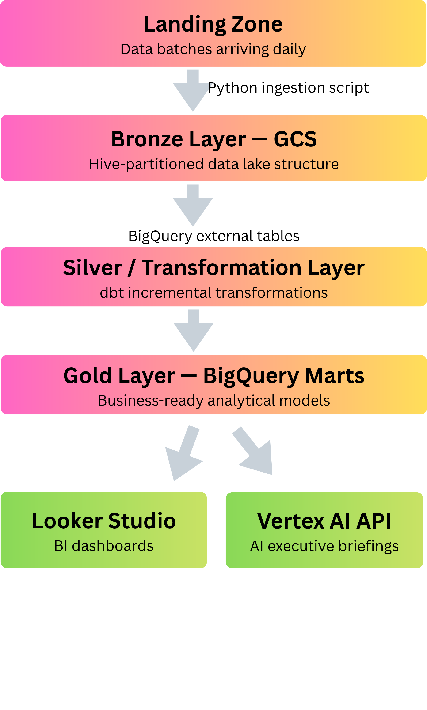

# Cloud-Based Financial Data Platform & AI-Powered Executive Reporting 

**Technologies: Python, Terraform, GCS, BigQuery, dbt, Pandera, Elementary, Looker Studio, Vertex AI, GitHub Actions**

Built an end-to-end cloud data platform on GCP that automates data transformations, centralizes business metrics, and delivers consistent reporting across finance, inventory, and customer analytics.

This project demonstrates real data platform development in GCP: infrastructure provisioning, ingestion, data quality enforcement, transformation, production execution, incident investigation and remediation.

## Project Demonstration

Watch the end-to-end production pipeline:

https://github.com/user-attachments/assets/27f8d8f8-6b99-42bb-8737-4f6c629c6acd

---

## Architecture

---

## Key Engineering Work

- **Infrastructure:** Provisioned GCP storage infrastructure and IAM using Terraform.

- **Ingestion:** Developed Python-based ingestion from a GCS landing zone into a Hive-partitioned Parquet bronze layer, with Pandera validation.

- **Transformation:** Built incremental dbt models and BigQuery marts to centralize business logic and reporting metrics.

- **Data quality:** Integrated Elementary for dbt observability and data quality monitoring.

- **Semantic layer:** Defined 21 business metrics across four semantic models.

- **Reporting and AI:** Connected the marts to Looker Studio dashboards and integrated Vertex AI to generate structured daily financial briefings.

---

## Production Incident: Negative Net Revenue

During production validation, the finance dashboard showed negative net revenue.

I traced the issue to overlapping invoice classification rules: Amazon fee invoices beginning with "C" were incorrectly classified as cancellations.

### **Resolution:**

- Corrected the classification rule ordering.

- Fixed 65 additional misclassified records.

- Added a dbt test to prevent recurrence.

- Executed a production full refresh and verified the corrected results.

Read the detailed incident investigation [here](https://github.com/machaniG/bigquery-dbt-analytics/blob/main/Ad-Hoc-analysis.pdf).

### **Validation**

- Successfully executed the production dbt transformations.

- Verified incremental batch incorporation and resulting BigQuery model row counts.

- Confirmed the corrected finance reporting output after the full refresh.

### **Further Details**

[Architecture and lineage](https://github.com/machaniG/bigquery-dbt-analytics/blob/main/assets/lineage-graph.png)

[Detailed incident investigation](https://github.com/machaniG/bigquery-dbt-analytics/blob/main/Ad-Hoc-analysis.pdf)

[Source code](https://github.com/machaniG/bigquery-dbt-analytics/tree/main/dbt)

[Finance Revenue Tracking Dasboard](https://datastudio.google.com/s/tPn924FaW98)

