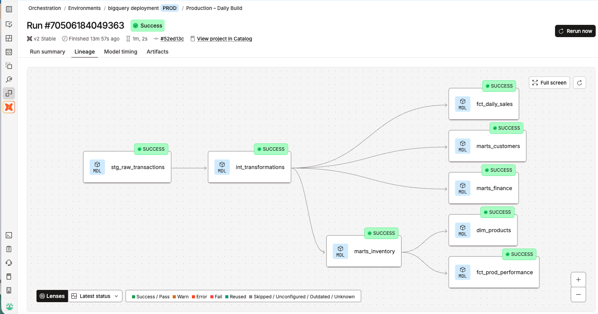
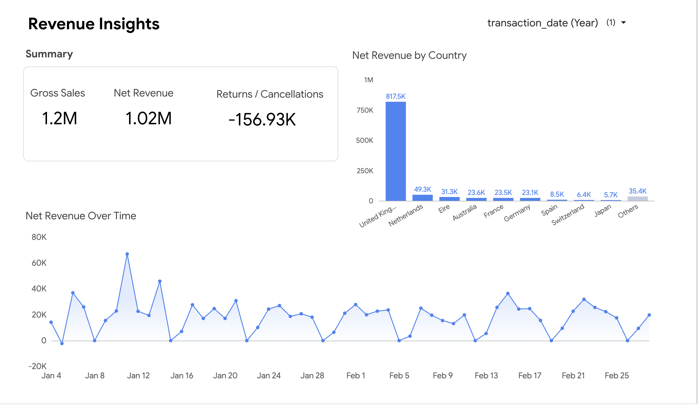
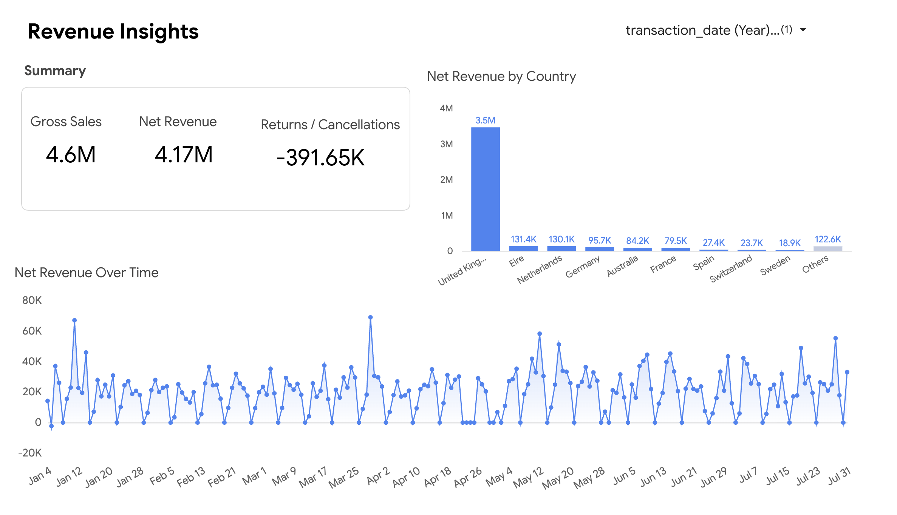

# End-to-End Analytics Engineering Pipeline with dbt, BigQuery & Looker Studio

## Overview

- And end-to-end ELT pipeline with automated dbt data transformations after raw data is loaded into Bigquery cloud data warehouse for E-commerce B2B dataset, utilizing incremental modeling that transforms and inserts only new or modified data into a table during a run, rather than rebuilding the entire table from scratch. 

- Marts contain the prepared data products.
- Semantic models describe their entities, dimensions, and measures.
- Metrics define the governed KPIs.
- Saved queries package those KPIs for a team or dashboard.

- **This gives Finance, Inventory, and Customer Analytics a shared, version-controlled definition of metrics such as net_revenue, net_units_moved, product_return_rate, and customer_lifetime_value.**

## Production Job Lineage Graph

----

## Analytic Pipeline

Google Cloud Storage Data Lake (Raw batches) &#10145; Bigquery Data Warehouse (External Tables) &#10145; dbt transformations (8 models + 4 semantic models, 21 metrics, 61 data tests) &#10145; Looker Studio (Inventory, Finance, & Customer Analytics Dashboards and Reporting)

## Dbt Model Layers

### Staging

Prepares a clean version of the raw table and derives transaction type.

### Intermediate

Prepares fact grain by turning classified staging lines into a stable, finance- and inventory-ready transaction-line grain.

| Responsibility | Example in the project |
| ------------------ | -----------------|
| Create a stable surrogate key | transaction_line_id from invoice, product, and line occurrence |
| Enforce one clear grain  | One row per invoice–product-line occurrence |
| Apply signed business values | Refunds/cancellations become negative revenue and quantity |
| Handle duplicates deliberately | Keep exact duplicate lines only if they are genuine separate lines; otherwise deduplicate with a documented rule |
| Join reference/enrichment data | Product attributes, customer attributes, country mapping, calendar |
| Prepare reusable calculations | gross_line_amount, signed_line_amount, signed_quantity |
| Isolate complex logic | So marts remains simple and readable |

### Marts

- Built 6 dbt marts that serve as the final, business-ready layer of data transformation.
- The marts are materialized as physical tables or incremental models inside BigQuery cloud data warehouse.
- They expose clean, curated, and entity-grained datasets directly to end users, BI dashboards, and reverse-ETL tools.

## Semantic Layer 

- Built 4 semantic models with 21 defined business metrics, establish the single source of truth for the business metrics and KPIs

----

## Data Quality and Observability

- Designed a total of 61 tests including generic/custom business-related tests e.g.,

1. Test derived logic

Testing the classification rule:

    - test_sales
    - test_returns
    - test_cancellations

2. Test sign conventions

The intermediate model promises:

- Sales have positive signed_line_amount.
- Returns/cancellations have non-positive signed_line_amount.
- signed_line_amount has the same magnitude as gross_line_amount. 
- These two tests protect Finance from accidentally reporting refunds as revenue.

    - test_non_negative
    - test_non_positive

3. Custom business tests

- Should return zero rows when valid.

    - test_net_revenue
    - test_returns_cancellations
    - test_sales_positive
    - test_returned_inventory

----

##  BI Dashboards for Stakeholders

- The centralized business logic/metrics were used for reporting by finance, inventory, and customer analytics teams, ensuring that so every downstream report uses the exact same logic and preventing conflicting numbers across teams. 

### Example Revenue Tracking Dashboard Enabled by my dbt Models for the Finance Team

Created a revenue tracking dashboard in Data Studio (Looker Studio) so the finance team can track revenue in real time without writing a single line of code. 

The dashboard below is filtered to the current year and is fully interactive to allow comparison over the years. Marts finance feeds this dashboard. Time and country allows for targeted revenue analysis / tracking by the finance team. 

**Revenue Tracking Dashboard before new batch arrival**

**Revenue Tracking Dashboard after the new batch arrival and scheduled dbt transformations**

----

## Successful Scheduled Transformations

What the logs confirm
The build log shows these models running in the dbt_analytics26 target:

| Model	| Materialization	| Result |
| --- | --- | --- |
| stg_raw_transactions |	View	| Succeeded |
| int_transformations	| Incremental	| Succeeded |
| marts_finance	| Incremental	| Succeeded |
| marts_inventory	| Incremental |	Succeeded |
| marts_customers	| Table	| Succeeded |
| fct_daily_sales	| Table	| Succeeded |
| fct_prod_performance	| Table	| Succeeded |
|dim_products	| Table	| Succeeded |

- The following results confirm that Batch 3 was incorporated into the production models

- The row counts and date ranges are consistent across the intermediate model and both marts, and the daily sales fact table also contains dates through July 2011.

Results 

| Production model | Total rows	| Batch 1	| Batch 2	| Batch 3	| Latest date
| ----| -----| -----| -----| -----| ------|
| int_transformations |	788,359 |	365,825	| 242,448 |	180,086	| 2011-07-31 |
| marts_finance	| 788,359 |	365,825	 | 242,448	| 180,086	| 2011-07-31 |
| marts_inventory |	788,359	| 365,825	| 242,448	| 180,086	| 2011-07-31 |
| fct_daily_sales	| 2,519	| 1,167	| 703	| 649	| 2011-07-31 |

- which means:

    1. The source update reached the intermediate model. It contains 180,086 rows dated March–July 2011, matching the increase observed in total records after uploading Batch 3.
    2. Both marts contain the same batch coverage and row counts as the intermediate model. There is no sign of Batch 3 being excluded from these models.
    3. The daily sales fact table includes Batch 3. Its 649 rows represent aggregated daily records, rather than individual transactions, so its count is expected to be much smaller.

